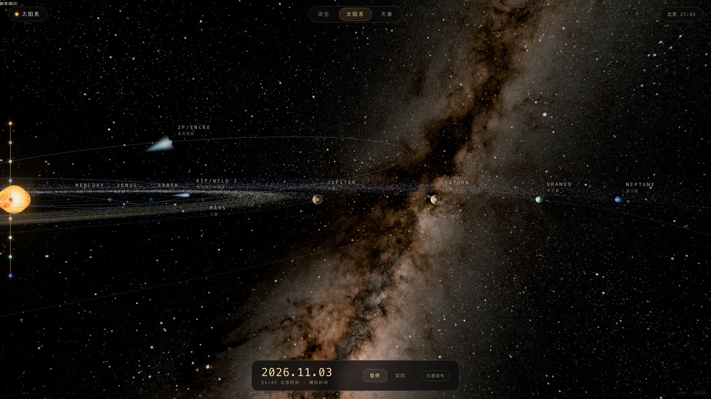
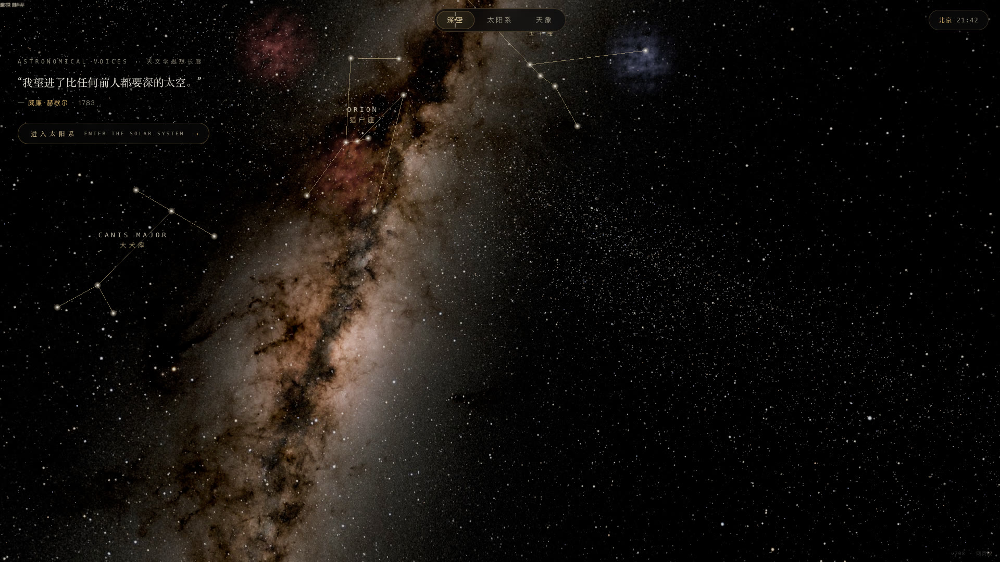
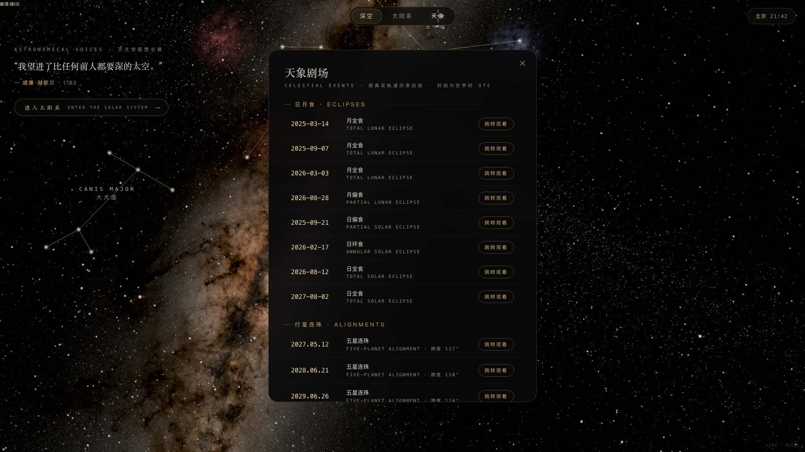

# 星际模拟 · Interstellar Atlas

**纯前端三维太阳系模拟**：从深空星野飞入太阳系，看八大行星按真实历表运行、彗星拖着尾巴扫过近日点，还能一键跳进真实的日食 / 月食 / 五星连珠现场。

<p align="center">
  <a href="https://zkb-1271.github.io/interstellar-atlas/"><b>🌐 在线直接看</b></a> · <a href="#-快速开始">本地运行</a> · <a href="#-离线单文件">离线单文件</a> · <a href="#-素材与授权">素材授权</a>
</p>

| 太阳系总览 | 深空模式 | 天象剧场 |
| --- | --- | --- |
|  |  |  |

*真机截图 —— 八大行星 + 小行星带 + 双彗星 + 银河天球（NASA/Spitzer 全景）；天象面板内置 2025–2027 真实日月食日期。*

---

## 🚀 快速开始

**方式一：在线看（什么都不用装）**

直接打开 <https://zkb-1271.github.io/interstellar-atlas/>

**方式二：本地运行（开发 / 二开）**

```bash
git clone https://github.com/zkb-1271/interstellar-atlas.git
cd interstellar-atlas
npm run dev          # 等价于 python3 serve.py 8823（响应带 no-store，改代码刷新即生效）
open http://127.0.0.1:8823
```

macOS 也可以直接双击 **启动.command**。必须走 http 访问（ES Module 与本地图片在 `file://` 下会被浏览器拦截）。完全离线可用，Three.js r160 已放在 `lib/`。

**方式三：离线单文件（双击即开，不发部署）**

```bash
npm install          # 首次：安装 esbuild
npm run build        # 全尺寸版（默认）
npm run build:web    # 压缩版，与网页版资源一致
```

| 命令 | 行星贴图 | 银河天球 | 体积 |
|---|---|---|---|
| `npm run build` | 4096×2048 / q95 | 8192×4096 原图（需本地 `assets/tex/sky/milky-way-8k.jpg`，不进 Git） | ≈62 MB |
| `npm run build:web` | 4096×2048 / q84 | 4096×2048 | ≈27 MB |

原理：`file://` 下浏览器会拦截 ES 模块与本地图片请求，所以构建时把 JS 打成传统脚本、所有贴图转成 data URI 内联进同一个 HTML（`js/assets.js` 的 `assetURL` 负责路径映射；全尺寸版从 `assets/full/` 取同名高质量版本）。产物在 `dist/`。

## ✨ 功能

- **深空模式**：四层恒星 + 银河带 + 暖褐星云，拖动环视；左上轮换天文名言，一键"进入太阳系"。
- **太阳系**：八大行星 + 月球按 JPL 开普勒轨道要素随真实日期运行；土星环（含卡西尼缝）、小行星带、地球云层；底部时间栏支持 暂停 / 实时（悬停调倍速 ×60 – ×86400）/ 示意排布与实时轨道切换。
- **彗星**：哈雷 1P、恩克 2P、67P、维尔特二号 81P，按真实轨道要素沿椭圆运行，彗尾始终背向太阳、越近日越长越亮。
- **卫星**：14 颗卫星全部可悬停、可点开档案（木卫四大四颗、土卫六、海卫一、火卫一等）。
- **行星特写**：点行星或标签，相机飞近跟随，右浮档案卡（半径 / 重力 / 公转自转 / 温度 / 卫星），可上一颗下一颗。
- **日月食**：月食看月球钻进地影（半影变暗、本影红铜色自发光）；日食看月影锥投向地球、地球向阳面出现本影暗斑。内置 2025–2027 真实食甚时刻，一键跳转。
- **观景位**：天象播放时提供 远景 / 侧视 / 近景 / 地面 四套机位——地面视角是"站上地球表面仰望天空"（月食看红月当空、日食看月亮吞日），带自动环绕。
- **五星连珠**：自动扫描未来十年水金火木土地心视黄经跨度谷值，跳转观看。
- **冷知识**：每个天体档案卡底部 2–3 条 `FIELD NOTES`，一句话 + 具体数字。
- **触屏 / 平板**：自动静默适配（无任何模式提示）——单指拖拽旋转、双指捏合缩放、点按选星/开档案、点「实时」呼出倍速面板（点外部收起）。

## 🛠 技术实现

纯前端，零框架依赖（仅 Three.js r160 + addons，已本地化），无后端、无 API。

```
index.html          入口（importmap 指向本地 lib）
css/style.css       黑金视觉 / 中英混排
js/data.js          轨道要素、行星/卫星/彗星档案、冷知识、天象日期、名言
js/astro.js         儒略日、开普勒方程、月球历表、连珠搜索
js/textures.js      程序化贴图（行星表面 / 云层 / 星环 / 辉光 / 星云）
js/starfield.js     恒星三层 + 银河 + 星云
js/solar.js         太阳 / 行星 / 轨道线 / 小行星带 / 地影锥
js/flight.js        相机飞行（贝塞尔 + 缓动）与天体跟随
js/ui.js            HUD：准星光标、金环、标签、时间栏、档案卡、天象面板
js/main.js          渲染循环、模式状态机、拾取、天象编排
js/assets.js        资源路径解析（离线版换成内联 data URI）
serve.py            本地静态服务（带禁缓存头）
build.mjs           单文件离线版打包脚本（esbuild）
lib/                three r160 + addons（本地，离线可用）
```

**精度口径**（诚实声明）：行星位置为 JPL 简化历表（百年级精度），月球用截断版 Meeus（~1° 误差），日月食日期取真实食甚时刻、几何做视觉夸张；连珠跨度为地心视黄经口径。

**两套轨道口径**：默认「示意排布」把行星压缩排在 +X 一线、配同心导轨圈；「实时轨道」走 JPL 历表、配 3000 段采样的真实椭圆（圈过行星，最大偏差 ≈ 1px）。轨道线半径换算与位置计算必须同源（`auToScene(a) × (p/a)`），否则离心率大的天体会"跑出"轨道。

更多开发与调试笔记（参考站对齐参数、相机/拖拽手感、档案卡样式约定、天球朝向扫描结论等）见 **[.internal/AGENTS.md](.internal/AGENTS.md)** 与 **[.internal/开发经验库.md](.internal/开发经验库.md)**。

## 🖼 素材与授权

- **行星 / 太阳表面贴图**：[Solar System Scope](https://www.solarsystemscope.com/textures/)（CC BY 4.0），原始 8K 素材降采样为 4K 使用（天王星、海王星、金星云顶官方最高为 2K）。
- **卫星表面贴图**：USGS Astrogeology 与 NASA/JPL 公开的全球影像镶嵌（公共领域）——木卫一/三/四为 Galileo–Voyager 彩色镶嵌，土卫六为 Cassini ISS 938nm 地表图，木卫二、土卫一/二/四/五、土卫八为 Voyager/Cassini 影像；天卫三、天卫四、火卫二目前只有局部影像，使用同类天体的真实影像按真实反照率着色（详见 `js/data.js` 中的 `tex` / `tint`）；火卫一为 Mars Express SRC 全球镶嵌。
- **银河全景**：NASA/Spitzer GLIMPSE 全景合成，降采样为 4096×2048，同时用作场景天球与开屏背景。
- **星座配图**：由本项目从上述 4K 银河全景按各星座真实赤经赤纬做透视投影裁切（1280×720），再叠加依星表绘制的星点与连线——背景是真实天空照片，不是插画或徽章。
- **星云配图**：NASA / JPL-Caltech 公开影像（Spitzer 红外、Hubble 可见光），经 NASA Images API 获取。
- **代码**：Three.js r160（MIT），其余为本项目实现，见 [LICENSE](LICENSE)。

## 📄 许可证

代码以 [MIT](LICENSE) 协议开源；贴图与影像素材遵循上表各自授权（使用时请保留对应署名）。
